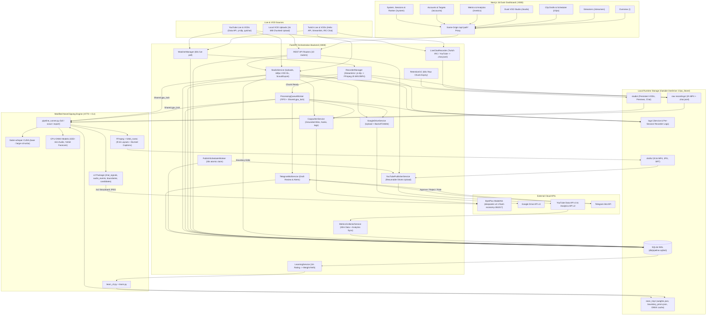

# ClipFarmer — Automated Livestream Clipping & YouTube Shorts Pipeline

ClipFarmer is a locally hosted, GPU-accelerated automation system that monitors Twitch and YouTube livestreams, records 2-hour stream chunks alongside live chat, extracts and renders captioned 9:16 vertical highlights using a modified **[NeonClipping](https://github.com/iamajmeena/neonclipping)** engine, drafts grounded YouTube Shorts metadata, backs up drafts to Google Drive, supports interactive timeline editing in **Dusk VOD Studio**, and publishes on-demand or on a local schedule to YouTube Shorts with closed-loop performance learning.

---

## Table of Contents

- [Core Clipping Processor: NeonClipping](#core-clipping-processor-neonclipping)
- [Modifications Implemented on Top of NeonClipping](#modifications-implemented-on-top-of-neonclipping)
- [System Architecture](#system-architecture)
  - [End-to-End Component & Data-Flow Diagram](#end-to-end-component--data-flow-diagram)
  - [Highlight Detection v2 & VOD Studio Pipeline](#highlight-detection-v2--vod-studio-pipeline)
- [How the Pipeline Works](#how-the-pipeline-works)
- [Web Dashboard & Dusk VOD Studio](#web-dashboard--dusk-vod-studio)
- [API Overview](#api-overview)
- [Runtime Storage Layout](#runtime-storage-layout)
- [Tech Stack](#tech-stack)
- [Quickstart & Operations](#quickstart--operations)
- [Configuration Reference](#configuration-reference)
- [Security & Privacy](#security--privacy)
- [License & Credits](#license--credits)

---

## Core Clipping Processor: NeonClipping

ClipFarmer uses **[NeonClipping](https://github.com/iamajmeena/neonclipping)** by **[Ajay K Meena](https://github.com/iamajmeena)** (MIT License, pinned to upstream commit `0525004`) as its core video clipping, transcription, facecam detection, vertical composition, and caption rendering processor.

### What Upstream NeonClipping Provides
- **Local Speech-to-Text (`faster-whisper` on CUDA):** Word-timed transcription (`base` and `large-v3-turbo`) with multi-language support.
- **Audio & Visual Activity Scoring:** Baseline-relative loudness jumps, raised-voice energy (2–4 kHz), optical-flow motion, flash/strobe, and scene cut density.
- **Automatic Facecam Detection:** Static-border + OpenCV YuNet face detection (`face_detection_yunet_2023mar.onnx`).
- **9:16 Vertical Composition & Burned-In Captions:** 11 native gaming/facecam layouts (`stack`, `blur`, `crop`, corner overlays, etc.) rendered via FFmpeg + `h264_nvenc`, with word-timed caption styles (`hormozi`, `clean`, `impact`, `mrbeast`, `gta_neon`) and `.srt` export.
- **Local Preference Ranker (`learn.py`):** Per-machine feature weight adaptation (`weights.json`) trained from clip ratings (`feedback.jsonl`).

---

## Modifications Implemented on Top of NeonClipping

To run unattended on multi-hour gaming/IRL livestreams and power an interactive VOD editor, we extended NeonClipping with a **Highlight Detection v2** package (`engines/neonclipping/v2/`), headless orchestration CLIs, multimodal VLM judging, improved boundary/framing logic, and two-stage `scout` / `export` execution.

### New Modules Added (`engines/neonclipping/`)

| File | Purpose |
|---|---|
| `pipeline_runner.py` | Headless CLI orchestrator called by the FastAPI backend. Supports `--mode full \| scout \| export`, `--min-score` VLM quality floor (`5.0`), `--chat-path`, `--boundary-priors-json`, `--clips-json` custom interval export, overlap filtering, and clean zero-clip output on quiet chunks. |
| `learn_cli.py` | Stdin/stdout JSON bridge letting the backend `LearningService` record clip ratings and refit `weights.json` without coupling to NeonClipping's web server. |
| `v2/chat_signals.py` | Multi-format chat replay signal extractor supporting live `.jsonl`, `TwitchDownloaderCLI` JSON, `chat-downloader` JSON, and YouTube `.live_chat.json`. Filters bots, `!commands`, and poll bursts; computes 10s unique-author velocity, reaction emote density, copy-paste waves, and auto-aligned `chat_lag_s` via cross-correlation. |
| `v2/audio_events.py` | CPU ONNX `CED-mini` (`model.int8.onnx`) AudioSet classifier detecting `laugh`, `scream`, and `cheer` probabilities using pure-NumPy 64-bin HTK log-mel spectrograms, with graceful empty-dict fallback if the model is unavailable. |
| `v2/boundaries.py` | Two-way `story_window()` boundary refiner. Moves `start` earlier to clean sentence/pause breaks (preserving buildup), extends `end` through reaction decay, clamps `min_len`/`max_len` without truncating payoffs, applies Pass-2 VLM judge timestamp hints (`setup_start`, `payoff`, `reaction_end`), and consumes/updates per-category priors (`boundary_priors.json`). |
| `v2/candidates.py` | Pure-NumPy 1D peak finder (`find_peaks_1d`) producing a fused multi-signal excitement curve (20–40 candidate peaks) and a downsampled `timeline_curve` (`<= 800` points) for Studio waveform rendering. |

### Upstream NeonClipping Files Modified

| File | Modifications Made |
|---|---|
| `smart.py` | Added a pre-roll guard in `snap()` to preserve silent gameplay buildup before `peak_sec`; added `extract_storyboard_grid()` generating `3×2` tiled JPEG contact sheets; implemented `judge_v2()` multimodal structured evaluation (`is_moment`, `category`, `on_screen`/`visual_summary`, `setup_start`, `payoff`, `reaction_end`, `scores`, `verdict`, `cut_reason`, `confidence`) with explicit stderr logging and conservative `0.25` fallback on judge errors (replacing silent `pass`). |
| `llm.py` | Added OpenAI-compatible multimodal `image_url` (base64 JPEG) payloads and `"thinking": {"type": "disabled"}` for DeepSeek V4.1 Economy on BytePlus ModelArk (~976 total tokens per `3×2` storyboard), plus an HTTP `400` fallback chain (`thinking` → `response_format` → text-only). |
| `highlights.py` | Added `peak_sec` tracking, 12-second onset backtracking with pre-roll preservation, and 3-pass stratified time-bucketed candidate discovery with `min_gap` so highlights spread evenly across 2-hour streams rather than clustering in one loud segment. |
| `curation.py` | Upgraded `select()` with duration-aware adaptive spacing and a temporal proximity decay penalty to prevent repetitive adjacent clips. |
| `facecam_detect.py` | Improved borderless/green-screen facecam tracking: lowered minimum face width (`22px`) and confidence (`0.72`), stabilized box coordinates using the median across matched frames, shaped crops to a `1.75:1` landscape ratio matching the `1080×614` top stack pane without slicing heads/chins, and disabled border inset on `face-only` detections. |
| `learn.py` | Extended `FEATURES` and `DEFAULT` preference weights with the new v2 signals: `chat_react`, `laugh`, and `judge`. |

---

## System Architecture

### End-to-End Component & Data-Flow Diagram



### Highlight Detection v2 & VOD Studio Pipeline

```mermaid
flowchart LR
    IN["Input Video (2h Live Chunk or Studio VOD)"] --> SIGNALS

    subgraph SIGNALS["1. Multi-Signal Extraction"]
        S_AUD["Audio Energy (Loudness Jump + 2-4 kHz Shout)"]
        S_EVT["CED-mini ONNX (Laugh, Scream, Cheer)"]
        S_CHAT["Chat Replay (10s Velocity, Reaction Emotes, Lag Alignment)"]
        S_VIS["Visual Motion (Optical Flow, Flashes, Cuts)"]
        S_ASR["CUDA Whisper (Word-Timed Transcript)"]
    end

    SIGNALS --> FUSE["2. Fused Timeline & Stratified Peak Finder (20-40 Candidates)"]
    FUSE --> GRID["3. 3x2 Storyboard JPEG Contact Sheet per Candidate"]
    GRID --> JUDGE["4. DeepSeek V4.1 Economy Multimodal Judge (thinking=disabled, VLM Floor >= 5.0)"]
    JUDGE --> BOUNDS["5. Two-Way Story Window (Pre-Roll Guard, Decay Tail, boundary_priors.json)"]

    BOUNDS -->|Auto Pipeline: --mode full| CURATE["Adaptive Curation & 9:16 NVENC Render"]
    BOUNDS -->|VOD Studio: --mode scout| TIMELINE["Dusk VOD Studio Timeline & Clip Inspector"]

    TIMELINE -->|User Trims Start/End + Adds/Deletes| FEEDBACK["Record boundary_feedback -> Update boundary_priors.json"]
    TIMELINE -->|Selected Clips: --mode export| CURATE

    CURATE --> COPY["Grounded AI Copywriter (Title, Description, Tags)"]
    COPY --> OUT["drafts/ (.mp4, .jpg, .srt) + Google Drive + Clips Queue"]
    OUT -->|Post Now / Schedule| SHORTS["YouTube Shorts"]
    SHORTS -->|Views & Retention + User Ratings| WEIGHTS["LearningService -> Refit weights.json"]
    WEIGHTS -.-> FUSE
    FEEDBACK -.-> BOUNDS
```



---

## How the Pipeline Works

### 1. Live Stream Watching & Recording
- `WatcherManager` polls enabled Twitch (Helix API) and YouTube channels every 60 seconds, with a 2-poll offline confirmation guard so brief API hiccups do not terminate recordings.
- `RecorderManager` launches `Streamlink` (Twitch, `--twitch-disable-ads`) or `yt-dlp` (YouTube) piped into FFmpeg segmenting into Matroska (`.mkv`) chunks (`CHUNK_DURATION_SECONDS = 7200`, i.e., 2 hours), then losslessly remuxes closed chunks to faststart `.mp4`.
- `LiveChatRecorder` runs alongside each recording (anonymous Twitch IRC / optional YouTube `pytchat`) and writes aligned `<chunk>.chat.jsonl` files beside the video.
- Short ending tails merge losslessly into the previous chunk; standalone sessions shorter than `MIN_STANDALONE_CHUNK_SECONDS` (`3600s`) are discarded unless stopped manually/interrupted (`min_partial_seconds = 300s`). On restart after a hard stop, `recover_interrupted()` salvages unclosed `.mkv` files automatically.

### 2. GPU-Locked Processing Queue & Highlight Detection v2
- `ProcessingQueueWorker` processes queued chunks sequentially under an `asyncio.Lock` (`gpu_lock`) shared with `StudioService`, ensuring live chunk clipping and VOD Studio scouting/exporting never contend for CUDA VRAM or NVENC sessions.
- `NeonClippingClient` invokes `engines/neonclipping/pipeline_runner.py` with per-streamer options (`layout`, `fallback_layout`, `caption_style`, `min_len`, `max_len`, `cam_auto`, `cam_box`, `clip_count`, `hashtags`), sibling `.chat.jsonl`, `boundary_priors.json`, and `VLM_MIN_SCORE = 5.0`.
- Candidates are discovered across stratified time buckets, evaluated by DeepSeek V4.1 Economy on a `3×2` JPEG storyboard + transcript + signal context, refined via two-way story-window boundaries, and rendered into 1080×1920 vertical MP4s with burned-in captions, `.srt` sidecars, and cover JPEG thumbnails.

### 3. AI Copywriting, Drive Archival & Telegram Review
- `CopywriterService` calls DeepSeek V4.1 Economy (`thinking: disabled`, `max_tokens: 400`) grounded in the clip transcript and VLM `visual_summary` to generate a Shorts title, description, and hashtags.
- `GoogleDriveService` uploads each rendered draft to a dedicated Google Drive account (`<Streamer>/<YYYY-MM-DD>/`) with 4-attempt exponential backoff on `429` / `403` rate-limit / `5xx` / transport errors.
- `TelegramBotService` sends draft notifications with inline buttons to approve, reject, or rate clips directly from mobile, plus alerts for recorder errors.

### 4. Dusk VOD Studio (`/studio`)
- Import full VODs either by **chunked 16 MB local upload** or directly by **Twitch / YouTube VOD URL** (`auto` / `streamlink` / `yt-dlp`, prioritizing **60fps** `1080p60` / `720p60` with 8 concurrent fragment threads, optional `start_time` / `end_time` slicing, optional chat replay fetch, and optional auto-analyze).
- Stream VODs via HTTP `206 Partial Content` range requests inside an interactive timeline editor displaying the downsampled excitement curve, draggable candidate start/end handles, add/delete clip controls, and a detailed Clip Inspector (VLM verdict, category, visual summary, signal breakdown, caption style, and layout settings).
- Exporting runs `pipeline_runner.py --mode export`, creates normal `clip_drafts` ready for scheduling/publishing, and records any manual boundary trims in `boundary_feedback` to refine `boundary_priors.json` over time.
- Studio VODs are stored in `Clips_Store/studio/` and are **never auto-deleted by `RetentionGC`** — they remain until manually deleted (mid-download deletes cleanly terminate the full subprocess tree and remove `.part` fragments).

### 5. Bulk Draft Management & Local Scheduled Publishing
- `/clips` supports multi-select (with `Shift+Click` range selection), bulk approve/post, bulk reject, bulk delete (up to 5,000 IDs, 500-row SQL batching, 150 ms Drive delete pacing), and bulk scheduling with configurable interval spacing.
- Every row and bulk toolbar includes a Dusk split **Post** button with a dropdown arrow (`Post now`, `Schedule post…`, `Reschedule…`, `Cancel schedule`) opening a Date/Time modal with quick presets and visibility override (`public`, `unlisted`, `private`).
- `PublishSchedulerWorker` polls every 30 seconds and atomically claims due `'scheduled'` clips before uploading via `YouTubePublisherService`. Scheduling locally instead of using YouTube's `publishAt` preserves YouTube's rolling 24-hour channel upload cap until the exact publish time arrives.

### 6. Analytics, Preference Learning & Storage Retention
- `MetricsCollectorService` syncs YouTube Data API v3 stats and Analytics API v2 watch-time/retention metrics into `metric_snapshots` every 30 minutes.
- `LearningService` translates user/performance ratings into `learn_cli.py` updates every 2 minutes to refit `weights.json`.
- `RetentionGC` runs every 60 seconds to clean up expired raw recording chunks once processing and merge locks clear, while never touching `drafts/` or `studio/`.

---

## Web Dashboard & Dusk VOD Studio

The Next.js 16 frontend uses a dark **Dusk** theme (`tokens.css`, `globals.css`, Tailwind v4, shadcn/ui `base-nova`) proxying all API requests through same-origin `/api/:path*`.

| Route | Function |
|---|---|
| `/` | Pipeline overview, live recordings, queue activity, and quick metrics |
| `/streamers` | Manage Twitch/YouTube streamers, `auto_watch` toggles, per-streamer clip/caption presets, and visual webcam box picker |
| `/clips` | Review drafts, inline player/metadata editing, multi-select bulk actions, Drive links, split Post/Schedule controls |
| `/studio` | Dusk VOD Studio: local upload & 60fps VOD URL import, timeline waveform editor, candidate inspector, custom clip export |
| `/metrics` | Published Shorts performance charts (Recharts), best-performing clips, and manual metrics sync |
| `/accounts` | Connect YouTube channels and dedicated Google Drive storage via OAuth, map streamer-to-channel publishing targets |
| `/system` | System health diagnostics, recording session logs ("Open in Studio"), and learned highlight ranker weights |

---

## API Overview

All endpoints are served by FastAPI on `http://127.0.0.1:8000` (interactive OpenAPI docs at `/docs`):

| Prefix | Key Capabilities |
|---|---|
| `/api/health` | Database (WAL), storage free space, FFmpeg/NVENC, NeonClipping `:8770`, and LLM configuration checks |
| `/api/auth` | Google/YouTube OAuth and separate Google Drive OAuth flows (CSRF state validation) |
| `/api/accounts` | Connected YouTube and Google Drive accounts management |
| `/api/streamers` | Streamer CRUD, `auto_watch` toggle, live preview frame capture, per-streamer clip/facecam options |
| `/api/targets` | Streamer → YouTube channel target mappings and default privacy/tags |
| `/api/clips` | Draft listing, inline video/thumbnail streaming, metadata PATCH, Drive upload, single/bulk approve/reject/delete/schedule, cancel schedule, publications history |
| `/api/studio` | 16 MB chunked upload (`init/chunk/complete`), `from-url` 60fps VOD import, HTTP `206` video streaming, scout (`analyze`), candidate edits, `export`, project deletion |
| `/api/system/queue` | Live chunk processing queue inspection, pause/resume, and manual retry |
| `/api/metrics` | Published Shorts analytics overview, time-series snapshots, manual sync trigger |
| `/api/system` | Active recordings, recent chunks/sessions, learning ranker weights summary, manual GC/learning triggers |

---

## Runtime Storage Layout

Heavy media files, SQLite databases, and logs live **outside OneDrive** to prevent file-sync locks during live recording, remuxing, and GPU transcoding:

```text
C:\Users\wirya\Documents\Clips_Store\
├── raw recordings\    # 2-hour stream .mp4 chunks + .chat.jsonl sidecars (auto-cleaned by RetentionGC)
├── drafts\            # Rendered 9:16 vertical .mp4 clips, .jpg thumbnails, .srt subtitles
├── studio\            # Uploaded & URL-downloaded VODs, previews, chat replays (kept until manually deleted)
├── neon_tmp\          # NEONCLIPPING_DATA_DIR (weights.json, boundary_priors.json, feedback.jsonl, ONNX models)
├── previews\          # Captured streamer frame previews for facecam box calibration
├── db\
│   └── pipeline.sqlite3  # SQLite database (WAL mode, 12 tables)
└── logs\              # Service logs (backend, neonclipping, frontend) + per-session recorder logs
```

### Repository Structure

```text
clip/
├── backend/                  # FastAPI API, SQLite schema, 10 routers, 19 services, pytest suite (95 tests)
├── frontend/                 # Next.js 16 + React 19 + Tailwind v4 Dusk dashboard & VOD Studio
├── engines/
│   └── neonclipping/         # Modified NeonClipping runtime (cloned via setup script; ignored in git)
├── scripts/
│   ├── setup_neonclipping.ps1  # Clones upstream NeonClipping & installs Python 3.12 + CUDA 12 runtime
│   ├── start_pipeline.ps1      # Launches NeonClipping (:8770), FastAPI (:8000), and Next.js (:3000)
│   ├── stop_pipeline.ps1       # Gracefully stops all pipeline services
│   ├── smoke_test_neon.py      # End-to-end CUDA, NVENC, faster-whisper, and /healthz verification
│   └── ux_studio_verify.py     # Live route & Studio workflow verification script
├── .env.example              # Environment variable template
├── PRIVACY.md                # Local data & Google OAuth privacy policy
└── README.md
```

---

## Tech Stack

| Layer | Technologies |
|---|---|
| **Backend** | Python 3.12, FastAPI, Uvicorn, Pydantic Settings, SQLite (WAL) via `aiosqlite`, `httpx`, `cryptography` (Fernet) |
| **Clipping Engine** | Modified [NeonClipping](https://github.com/iamajmeena/neonclipping), `faster-whisper` (CUDA 12 / CTranslate2), `onnxruntime` (CPU `CED-mini` + OpenCV `YuNet`), OpenCV, NumPy, FFmpeg (`h264_nvenc`) |
| **Capture & Ingest** | Streamlink, `yt-dlp`, `chat-downloader`, Twitch Helix API & IRC, YouTube Data API v3 & Analytics API v2 |
| **Multimodal VLM & Copy** | DeepSeek V4.1 Economy (`deepseek-v4-1-flash-economy-261017`) via BytePlus ModelArk OpenAI-compatible API |
| **Frontend** | Next.js 16.4, React 19, TypeScript 5, Tailwind CSS v4, shadcn/ui (`@base-ui/react`), Recharts, Motion, Sonner, Lucide Icons |

---

## Quickstart & Operations

### Prerequisites
- **OS:** Windows 10/11 (PowerShell 5.1+)
- **GPU:** NVIDIA GPU with CUDA 12 & NVENC (`h264_nvenc`) support
- **Runtimes:** Python 3.12, Node.js 20+, FFmpeg & FFprobe on `PATH`

### 1. Configure Environment
Copy `.env.example` to `.env` and populate your API keys and OAuth credentials:

```powershell
Copy-Item .env.example .env
```

> **Important:** Use the standard BytePlus ModelArk endpoint (`https://ark.ap-southeast.bytepluses.com/api/v3`). Do **not** use the Coding Plan endpoint (`/api/coding/v3`) for non-coding automation.

### 2. Install Backend, Engine & Frontend

```powershell
# Backend (Python 3.12 venv)
cd backend
py -3.12 -m venv .venv
.\.venv\Scripts\python.exe -m pip install -r requirements.txt
cd ..

# NeonClipping CUDA runtime (Python 3.12 venv + cuBLAS/cuDNN)
.\scripts\setup_neonclipping.ps1

# Frontend (Next.js production build)
cd frontend
npm install
npm run build
cd ..
```

### 3. Start & Stop All Services

```powershell
# Start NeonClipping (:8770), FastAPI (:8000), and Next.js (:3000)
.\scripts\start_pipeline.ps1

# Check live health
curl http://127.0.0.1:8000/api/health
curl http://127.0.0.1:8770/healthz

# Stop all services (check active recordings in /system before stopping!)
.\scripts\stop_pipeline.ps1
```

### 4. Run Tests & Diagnostics

```powershell
# Full backend test suite
cd backend
.\.venv\Scripts\python.exe -m pytest -q
cd ..

# CUDA / NVENC / faster-whisper engine smoke test
.\engines\neonclipping\.venv\Scripts\python.exe scripts\smoke_test_neon.py

# Frontend type-check & lint
cd frontend
npx tsc --noEmit
npm run lint
cd ..
```

---

## Configuration Reference

Key settings in `.env` (see [`.env.example`](.env.example) for defaults):

| Variable | Default | Description |
|---|---|---|
| `CLIPS_STORE_ROOT` | `C:\Users\wirya\Documents\Clips_Store` | Root media/DB directory (keep outside OneDrive) |
| `NEONCLIPPING_PORT` | `8770` | Local port for NeonClipping service |
| `LLM_MODEL` / `NEONCLIPPING_LLM_MODEL` | `deepseek-v4-1-flash-economy-261017` | Multimodal VLM judge & copywriter model |
| `CHUNK_DURATION_SECONDS` | `7200` | Live recording chunk length (2 hours) |
| `MIN_STANDALONE_CHUNK_SECONDS` | `3600` | Minimum standalone session duration (1 hour) |
| `VLM_MIN_SCORE` | `5.0` | Minimum VLM highlight score (`0–10`) required to keep a clip |
| `TOKEN_ENCRYPTION_KEY` | *(auto-generated)* | Fernet key encrypting OAuth tokens in SQLite |
| `TWITCH_CLIENT_ID` / `TWITCH_CLIENT_SECRET` | — | Twitch Helix live-status polling |
| `GOOGLE_CLIENT_ID` / `GOOGLE_CLIENT_SECRET` | — | YouTube Shorts publishing & Analytics OAuth |
| `GOOGLE_DRIVE_CLIENT_ID` / `GOOGLE_DRIVE_CLIENT_SECRET` | — | Separate Google Drive archival account OAuth |
| `TELEGRAM_BOT_TOKEN` / `TELEGRAM_ALLOWED_CHAT_IDS` | — | Optional Telegram draft notification & approval bot |

---

## Security & Privacy

- **Encrypted Credentials at Rest:** All Google/YouTube and Google Drive OAuth access and refresh tokens are encrypted using a local Fernet key (`TOKEN_ENCRYPTION_KEY`) before storage in SQLite.
- **Local-Only Exposure:** All services bind strictly to `127.0.0.1` (`:3000`, `:8000`, `:8770`) with strict CORS origins (`localhost:3000` / `127.0.0.1:3000`).
- **Path & URL Guards:** Draft/Studio file operations enforce `resolve_safe_path` containment checks, and Studio VOD URL downloads enforce a strict Twitch/YouTube host allowlist.
- **Privacy Policy:** See [`PRIVACY.md`](PRIVACY.md).

---

## License & Credits

- **Core Clipping Processor:** [NeonClipping](https://github.com/iamajmeena/neonclipping) by **Ajay K Meena** — MIT License (`Copyright (c) 2026 Ajay K Meena and NeonClipping contributors`).
- **Audio Event Detection:** `CED-mini` ONNX AudioSet model.
- **Face Detection:** OpenCV `YuNet` (`face_detection_yunet_2023mar.onnx`, MIT License).
- **Speech Recognition & Media Tooling:** `faster-whisper` (CTranslate2), `FFmpeg`, `Streamlink`, and `yt-dlp`.
